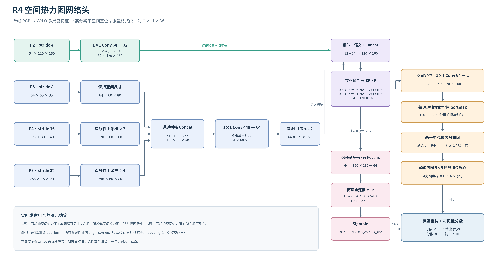

# Annotation_Yolo11n

面向机器人任务的**语义中心点标注、人工复核与空间定位**工具。保留YOLO11n特征网络，融合P2浅层细节和P3/P4/P5语义，预测每类目标的空间热力图与可见性。



## 仓库包含什么

- RoboDojo HDF5抽帧、按整条轨迹固定训练/验证/测试划分。
- 完全离线的浏览器点标注页面，支持可见、确认不可见、忽略、未处理，以及JSON导入导出。
- 可配置类别数的YOLO11n空间热力图网络、同步几何增强和掩码损失。
- 训练、像素误差评估、单图推理，以及未复核模型候选生成。
- 原R4推理包兼容接口；可将新空间坐标与已有YOLO可见性模型组合。

这是定制点定位模型，输出为语义中心点和空间分布。`epoch*.pt`应通过本仓库推理入口加载。当前方法每类输出一个中心，多个同类实例需要另行设计实例区分。方向敏感的类别使用几何增强前，应确定翻转后的类别对应关系；可用`--no-augment`关闭增强。

本仓库范围是标注与YOLO11n空间模型。另一个正在进行的PaliGemma/VLM20k热力图训练属于独立项目，其网络、处理器和训练配方没有混入这里。

## 安装

验证环境：Python3.10、PyTorch2.7.1+CUDA12.8、Ultralytics8.4.193。可使用CPU推理；训练按可用硬件选择`--device`。

```bash
python -m venv .venv
source .venv/bin/activate
pip install -e '.[test]'
annotation-yolo --help
```

模型初始化默认使用`yolo11n-pose.pt`。首次使用时Ultralytics可能下载通用权重；离线使用可以传入本地权重路径。已训练的空间检查点加载时从安装包内YAML构造网络，不需要再次下载初始化权重。

## 1. 准备标注包

```bash
annotation-yolo prepare \
  --source /path/to/RoboDojo_depth/deposit_coin/arx_x5/data \
  --config configs/deposit_coin.json \
  --output data/deposit_coin_kit
```

默认冻结约80%训练、10%验证、10%测试的轨迹划分，然后抽取24条训练与6条验证轨迹，每条7个时刻、每时刻3路相机。完整100条时得到首轮630张。原JPEG按源HDF5字节保存，记录哈希、原轨迹与帧号；已保留的测试轨迹不进入标注包。

已有划分时传`--split-policy split_policy.json`，文件包含`train_episodes`、`val_episodes`、`test_episodes`，不得随轮次重划分。数据较小时按实际轨迹数缩减抽样。配置中可以更改类别、定义、相机和抽帧数量。

解压/保留整个标注包，打开`开始标注.html`。不需要启动服务器。导出的JSON与原RGB图片一起构成训练输入。

## 2. 人工标注与校验

每张图每个目标都需要处理。只标能确认的指定中心；确定被挡或出画选不可见；身份/位置无法判断选忽略。完成全部目标后点击完成本图，并定期导出JSON。

```bash
annotation-yolo validate /path/to/export.json \
  --images-root data/deposit_coin_kit --for-training
```

- `visible`：原图像素`point_xy=[x,y]`，训练位置及可见性。
- `not_visible`：`point_xy=null`，只训练不可见性。
- `ignore` / `pending`：位置和可见性损失均屏蔽。
- `reviewed=false`：训练时整张图排除，模型候选不能冒充人工真值。
- `training_allowed=false`：验证复核/独立测试文件，禁止作为训练入口。

参见[标注格式](docs/annotation_format.md)和[合成JSON示例](examples/annotations.example.json)。示例没有配套真实图片，仅用于展示格式。

## 3. 训练空间模型

```bash
annotation-yolo train \
  --annotations /path/to/human_export.json \
  --images-root data/deposit_coin_kit \
  --backbone /path/to/yolo11n-pose.pt \
  --output runs/deposit_coin \
  --device cuda:0
```

默认80轮、batch8，YOLO特征层学习率5e-5，新头3e-4，AdamW、weight_decay5e-4、余弦调度；输出空间图是640×480输入的1/4，即160×120。位置监督为sigma1.5格的归一化高斯空间交叉熵，另加已知状态的平衡可见性BCE。只有人工确认的训练轨迹进入优化器。

训练输出`best.pt`、固定间隔检查点、原始标注快照、校验记录和验证预测。默认按置信度0.5、原图距离10像素计算F1来选择共享检查点。验证参与选模，不能称为独立测试。

`--initial-checkpoint`可以载入空间模型继续微调，但优化器重新初始化，不是恢复中断训练。`--input-size WIDTH HEIGHT`要求两维均能被32整除；原R4方案使用640×480。

原硬币R4实验以任务微调后的R3共享YOLO权重初始化，且使用相机检查点/可见性组合。通用YOLO权重默认训练命令是可复用起点，不能保证直接得到原实验数值。[实验范围与来源](docs/provenance.md)记录了这些区别。

## 4. 推理与候选标注

```bash
annotation-yolo predict /path/to/image.jpg \
  --checkpoint runs/deposit_coin/best.pt \
  --device cpu --output outputs/prediction.json \
  --heatmaps outputs/heatmaps.npz
```

输出坐标属于输入原图。低于阈值的点输出`null`。NPZ中包含条件空间分布、可见性分数和有效掩码；这些是模型预测。

对已有R4私有推理包：

```bash
annotation-yolo predict /path/to/image.jpg \
  --bundle /path/to/R4_bundle --camera cam_head \
  --device cpu --output outputs/prediction.json
```

R4包的`camera_routing.json`、`inference_contract.json`和对应`weights/`必须完整。可用`scripts/export_r4_bundle.py`从已有包复制必要文件。权重保留外部，不随代码仓库发布。

生成待人工复核的候选包：

```bash
annotation-yolo propose \
  --annotations data/deposit_coin_kit/manifest.json \
  --images-root data/deposit_coin_kit \
  --checkpoint runs/deposit_coin/best.pt \
  --output data/candidate_review
```

候选均保持`reviewed=false`，低置信度保持`pending`；已填写的人工作业不会被候选覆盖。保留的测试轨迹排除。导出人工复核JSON后再进入下一轮训练。

若要比较不同空间检查点与旧可见性模型，可用`scripts/select_routing.py`。它在开发验证集上选择组合并输出可独立加载的bundle，详细命令见[网络与选择规则](docs/method.md)。

## 测试与代码位置

```bash
pytest -q
```

- `model.py`：P2/P3/P4/P5融合、空间输出及局部质心解码。
- `losses.py`：位置与可见性损失，未知状态掩码。
- `data.py`：图像、点、可见性同步增强。
- `schema.py`：状态、坐标、哈希和轨迹隔离校验。
- `kit.py`、`templates/annotate.html`：抽帧、离线人工标注、候选复核。
- `train.py`、`inference.py`：训练、评估与可移植推理。

结构图：[PNG](docs/network_head.png) / [可编辑SVG](docs/network_head.svg)。

本项目采用AGPL-3.0，依赖Ultralytics YOLO11n。见[LICENSE](LICENSE)和[NOTICE](NOTICE)。
