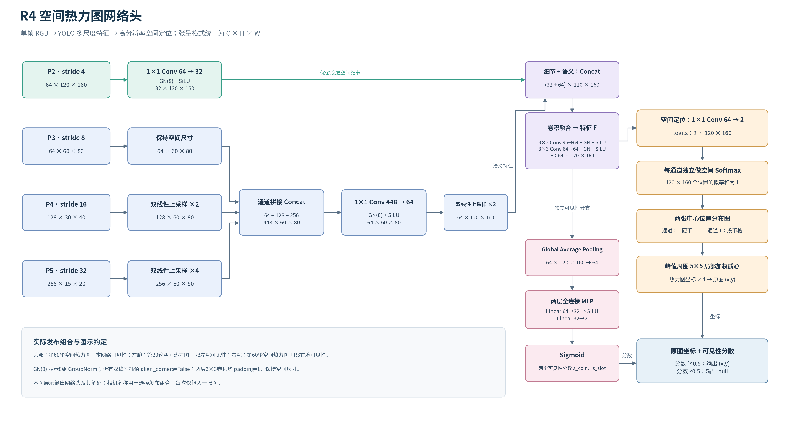

# 网络、损失与模型选择



输入为单帧RGB，默认640×480。张量按C×H×W表示：P2=64×120×160，P3=64×60×80，P4=128×30×40，P5=256×15×20。四级特征来自YOLO11n模块2、16、19、22；现有Pose输出模块移除。

P3/P4/P5双线性对齐到60×80后拼接448通道，1×1卷积压缩到64通道（GroupNorm8组+SiLU），上采样到120×160。P2用1×1卷积64→32（GN+SiLU），与语义分支拼接96通道。两层3×3卷积96→64→64各接GN+SiLU，padding1。

输出分支：1×1卷积64→K，得到K张位置logits。另将融合特征全局平均池化，经Linear64→32、SiLU、Linear32→K得到可见性logits。类别K可配；网络通道顺序必须等于标注classes。

空间损失对每个可见人工点生成sigma1.5格的归一化高斯，用空间Softmax交叉熵监督；按活跃类别平均。可见性对已知正负状态分别平均，再按活跃类别平均。未知项的位置和可见性梯度均为零。确认不可见只训练可见性，不预测隐藏坐标。

增强同步处理RGB与中心：50%水平翻转；75%概率使用缩放0.9～1.1、平移各5%的仿射；点移出画面则变为不可见；颜色增益0.85～1.15及亮度偏移±8。方向敏感任务需修改翻转类别映射或关闭增强。

解码在空间最大值附近5×5范围做局部Softmax质心，按输出网格与原图比例还原像素。可见性低于0.5时隐藏输出坐标。空间分布本身始终有峰值，不能用峰值代替可见性判定。

## 相机组合选择

原R4在固定的20/40/60/80轮检查点上比较：完整空间模型，或空间坐标加旧R3可见性；并保留旧模型作为实验对照。最终头部使用第60轮空间/可见性，左腕使用第20轮空间+R3左腕可见性，右腕使用第60轮空间+R3右腕可见性。

复用已有标准YOLO可见性权重时，`visibility_bundle/camera_routing.json`包含classes、cameras，每路提供相对weights路径及SHA256；使用R3发布包即可。

```bash
python scripts/select_routing.py \
  --annotations /path/to/human_labels.json \
  --images-root /path/to/kit \
  --checkpoints runs/deposit_coin/epoch20.pt runs/deposit_coin/epoch40.pt \
                runs/deposit_coin/epoch60.pt runs/deposit_coin/epoch80.pt \
  --visibility-bundle /path/to/R3_bundle \
  --output runs/selected_bundle --device cpu
```

这个脚本选择空间检查点和可见性组合，不修改人工标注，不进行梯度训练；不同任务可以省略visibility-bundle。组合选择使用开发验证集，不是独立测试。

本标注网络不使用深度、相机内外参、机器人状态、动作标签、未来帧或多相机同时融合。相机名称只用于路由，图像每次独立处理。
